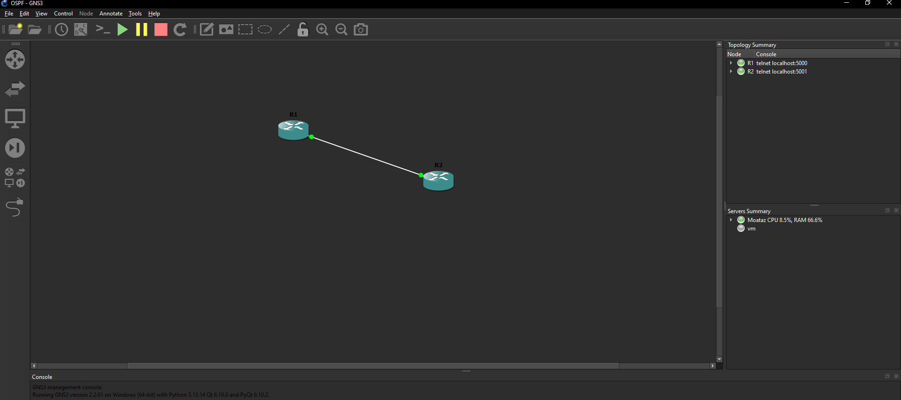

# Two-Router OSPF Area 0 Lab

## 1. Project Overview

This project implements a two-router OSPFv2 lab using GNS3 and Cisco IOS. It demonstrates OSPF neighbor formation, loopback route advertisement, packet-level analysis using Wireshark, and route withdrawal during a simulated silent OSPF failure.

The lab focuses on understanding how OSPF establishes and maintains adjacencies and how routing information changes when Hello packets are no longer received.

## 2. Lab Environment

| Component | Details |
|---|---|
| Network Emulator | GNS3 |
| Router Platform | Cisco C7200 |
| IOS Version | 12.4 |
| Routing Protocol | OSPFv2 |
| OSPF Process ID | 1 |
| OSPF Area | 0 |
| Packet Analyzer | Wireshark |

## 3. Network Topology



Two Cisco routers are connected through a point-to-point Ethernet link using a /30 subnet.

### IP Addressing

| Device | Interface | IP Address | Purpose |
|---|---|---|---|
| R1 | FastEthernet0/0 | 10.0.0.1/30 | Inter-router link |
| R1 | Loopback0 | 1.1.1.1/32 | Advertised test route |
| R2 | FastEthernet0/0 | 10.0.0.2/30 | Inter-router link |
| R2 | Loopback0 | 2.2.2.2/32 | Advertised test route |

## 4. OSPF Configuration

Both routers run OSPF process 1 in Area 0.

- R1 uses Router ID `1.1.1.1`.
- R2 uses Router ID `2.2.2.2`.
- The inter-router interfaces participate in OSPF.
- Loopback interfaces are configured as passive interfaces.
- Both loopback networks are advertised through OSPF.

The router configurations are available here:

- [R1 Configuration](configs/R1-running-config.txt)
- [R2 Configuration](configs/R2-running-config.txt)

**Configuration note:** These are curated project configurations based on the running configurations captured during the lab. Unrelated default and platform-specific lines have been omitted.

## 5. Verification and Results

The following tests were successfully performed:

- Established an OSPF neighbor adjacency in the FULL state.
- Verified that R2 learned the `1.1.1.1/32` loopback route through OSPF.
- Confirmed the next hop was `10.0.0.1`.
- Successfully pinged R1's loopback address from R2.
- Captured OSPF Hello packets from both routers using Wireshark.
- Verified the Hello and Dead intervals in the captured packets.

### Routing Verification

Expected OSPF route on R2:

```text
O 1.1.1.1 [110/2] via 10.0.0.1
```

### OSPF Neighbor Verification

The adjacency was successfully established between R1 and R2, reaching the FULL state.


## 6. Wireshark Packet Analysis

Wireshark was used to inspect OSPF Hello packets exchanged between the routers.

Observed packet characteristics:

| Field | Observed Value |
|---|---|
| Protocol | OSPF (IP Protocol 89) |
| Packet Type | Hello |
| Destination | 224.0.0.5 |
| Hello Interval | 10 seconds |
| Router Dead Interval | 40 seconds |
| Network Mask | 255.255.255.252 |

Useful Wireshark display filters:

```text
ospf
```

R1 Hello packets only:

```text
ospf && ip.src == 10.0.0.1
```

### Captured Packet Files

- [Baseline OSPF Hello Capture](captures/01-OSPF-Hello-Baseline.pcapng)
- [Silent Failure Test Capture](captures/02-Silent-Failure-Test.pcapng)

## 7. Simulated Silent OSPF Failure

A silent OSPF failure was simulated by configuring R1's FastEthernet0/0 as a passive interface under OSPF.

This stopped OSPF Hello transmission without shutting down the physical interface.

### Observed Behavior

1. R1's FastEthernet0/0 remained physically operational (`up/up`).
2. R1 stopped sending OSPF Hello packets on that interface.
3. R2 stopped receiving Hello packets from R1.
4. R2 detected the neighbor failure through the Dead timer expiration.
5. The OSPF neighbor entry was removed.
6. The route to `1.1.1.1/32` was withdrawn from R2's routing table.
7. Removing the passive-interface configuration restored the adjacency and the route.

### Route Withdrawal Evidence


## 8. Failure-Test Timing Observations

The R2 log recorded the neighbor transition from FULL to DOWN with the message:

```text
Neighbor Down: Dead timer expired
```

The event occurred at `18:54:16.671` Egypt time (`16:54:16.671 UTC`).

A captured Hello packet from R1 was timestamped `16:54:07.501067 UTC`. The difference between these timestamps was approximately **9.170 seconds**.

This is not claimed as the OSPF failure detection time. The capture may not include the preceding Hello packet, so these timestamps do not establish when R2 last received a Hello.

The interval between the neighbor-down event and the later neighbor-restored event was **241.880 seconds**. This includes the time during which the passive-interface configuration remained enabled and is not a measured convergence time.

**A controlled convergence measurement remains a future task.** It should use a continuous timestamped probe and a packet capture started before introducing the failure.


## 9. Skills Demonstrated

- Cisco IOS configuration and troubleshooting
- OSPFv2 routing and neighbor formation
- IPv4 subnetting and loopback addressing
- Routing table analysis
- Wireshark packet capture and protocol analysis
- Network failure simulation and route withdrawal
- Technical documentation and GitHub project management